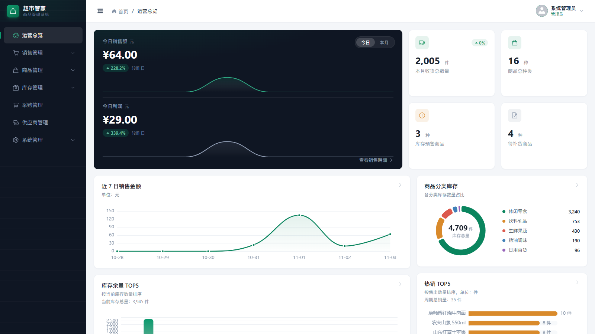
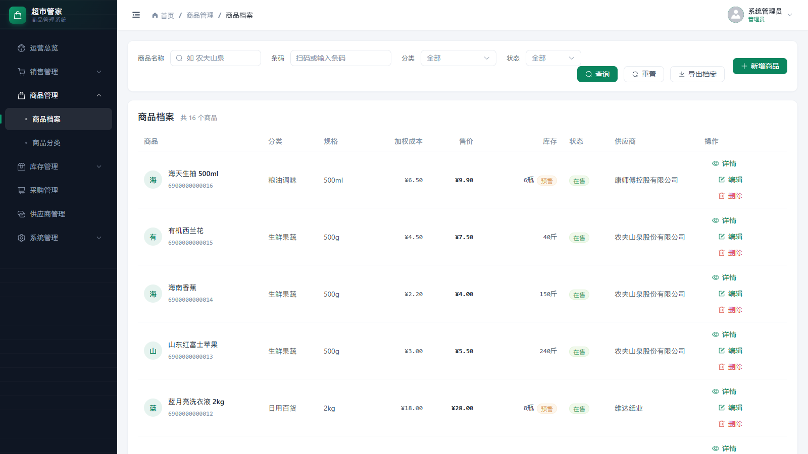
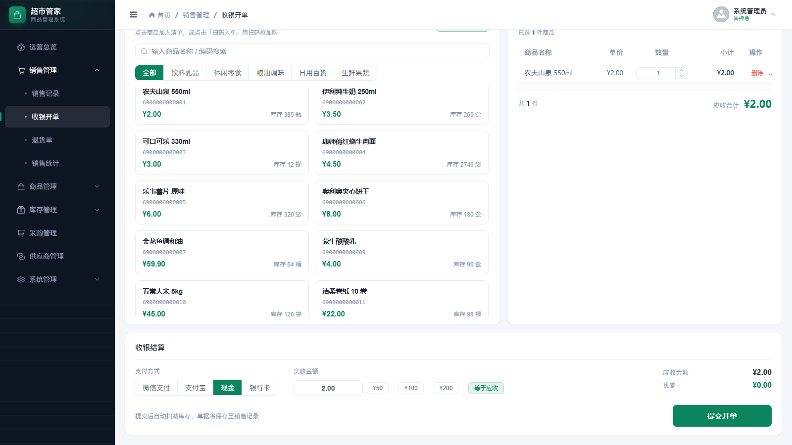
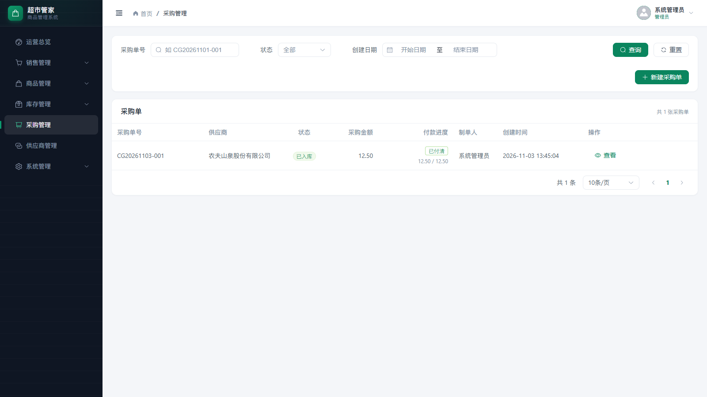
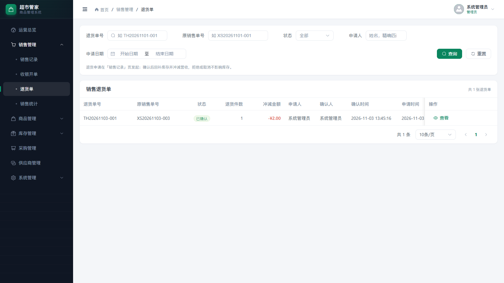
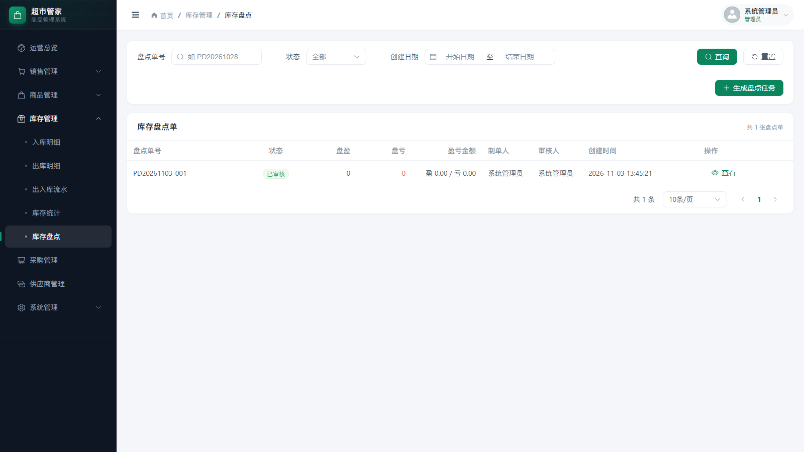
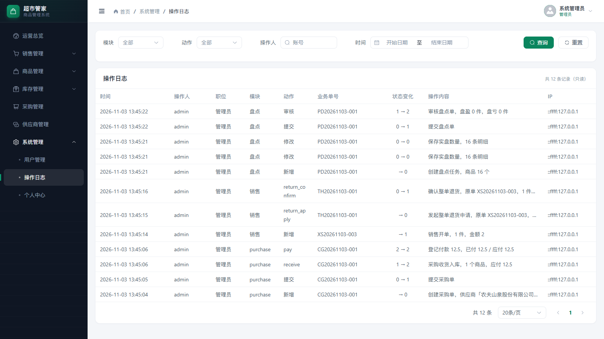
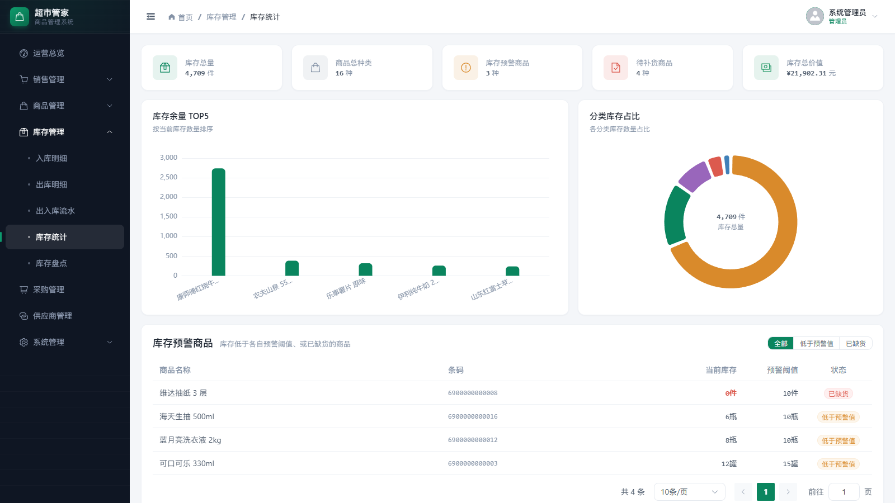
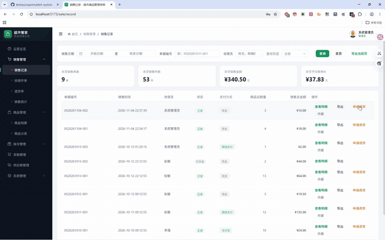

# 超市管家 · 超市商品后台管理系统

[](https://github.com/keleau/supermarket-system/actions/workflows/backend-test.yml)

面向单店超市的进销存后台管理系统，覆盖商品档案、库存、采购、销售、退货、盘点、供应商、经营分析和系统管理。前后端分离：前端使用 Vue 3 + Vite + Element Plus，后端使用 Node.js + Express 5 + MySQL。

> 项目定位：课程设计 / 毕业设计项目。重点实现完整的业务闭环、事务一致性、权限隔离和可验证的测试链路；不包含会员营销、线上支付、多门店等商业系统能力。

**仓库：** [Gitee](https://gitee.com/keleau/supermarket-system) · [GitHub 镜像](https://github.com/keleau/supermarket-system)

<p align="center">
  
</p>

## 30 秒速览

> 如果只看 30 秒：这是一个能完整跑通「商品建档 → 期初入库 → 收银开单 → 退货 → 盘点 → 采购收货 → 付款」的单店进销存后台。重点不是页面数量，而是库存可追溯、成本可计算、权限能落到后端。

- **业务闭环**：商品/供应商 → 入库 → 销售 → 退货/作废 → 盘点修正；采购单收货后自动入库并生成应付。
- **关键设计**：加权平均成本、单据驱动库存、事务 + 行锁、6 类岗位权限、成本/毛利/采购金额脱敏。
- **可验证指标**：14 张表、69 个接口、105 个后端单测、12 步浏览器 E2E。
- **技术栈**：Vue 3 + Element Plus + Pinia / Node.js + Express 5 + MySQL 8 / JWT。

| 快速入口 | 位置 |
| --- | --- |
| 页面截图 | [查看界面截图](#界面截图) |
| 演示预览 | [▶ 点击直接观看 12 秒 GIF](docs/assets/previews/demo.gif) |
| 完整视频 | [GitHub 文件页](https://github.com/keleau/supermarket-system/blob/main/docs/assets/demo.mp4) · [Gitee（需下载后观看）](https://gitee.com/keleau/supermarket-system/raw/main/docs/assets/demo.mp4)（1 分 27 秒，8.6 MB） |
| 接口契约 | [backend/api.md](backend/api.md) |
| 测试与 CI | [测试与质量保障](#测试与质量保障) |

## 项目概览

| 指标 | 当前实现 |
| --- | --- |
| 数据表 | 14 张（商品、库存、销售、退货、采购、盘点、日志、用户等） |
| 后端接口 | 69 个业务路由 + `/api/health` 健康检查 |
| 后端单元测试 | 105 个用例 |
| 浏览器 E2E | 12 步连续点击流程 |
| 默认岗位 | 管理员、仓管、收银员、后勤、采购、会计 |

核心业务闭环：

```text
商品建档 → 期初入库 → 销售开单 → 退货申请 / 管理员确认 → 回补库存
供应商  → 采购制单 → 提交 → 仓管收货入库 → 生成应付 → 登记付款
盘点任务 → 实盘录入 → 提交 → 管理员审核 → 盘盈/盘亏修正库存
```

## 界面截图

> 截图来自临时数据库：执行 `db:init` 写入种子数据后，通过页面完成 1 笔采购、1 笔收银退货和 1 次盘点审核；不包含真实用户数据。

| 运营总览 | 商品档案 |
| --- | --- |
|  |  |
| **运营总览**：今日/本月销售额与利润、7 日趋势、分类库存、热销 TOP。 | **商品档案**：分类、库存预警、加权成本、售价、供应商与上下架状态。 |

| 收银开单 | 采购管理 |
| --- | --- |
|  |  |
| **收银开单**：商品扫码/搜索、购物清单、支付方式、实收与找零。 | **采购管理**：草稿 → 提交 → 收货入库 → 应付 → 登记付款。 |

| 退货单 | 库存盘点 |
| --- | --- |
|  |  |
| **退货单**：整单退货申请、管理员确认、库存回补与营收冲减。 | **库存盘点**：生成任务 → 实盘录入 → 提交 → 审核并修正库存。 |

| 操作日志 | 库存统计 |
| --- | --- |
|  |  |
| **操作日志**：关键动作、单据号、状态变化、操作人和 IP 留痕。 | **库存统计**：库存总量、分类占比、预警商品和积压商品。 |

### 演示预览（GIF 直接播放）

<p align="center">
  <a href="docs/assets/previews/demo.gif"></a>
</p>

> 上方为 12 秒 GIF 节选，点击图片可查看完整尺寸；由真实运行录屏生成，不是设计稿。
>
> 完整演示视频：[GitHub 文件页](https://github.com/keleau/supermarket-system/blob/main/docs/assets/demo.mp4) · [Gitee（需下载后观看）](https://gitee.com/keleau/supermarket-system/raw/main/docs/assets/demo.mp4)（1920×1200，1 分 27 秒，8.6 MB，含音频）。
>
> GIF 可直接播放；GitHub 文件页对 MP4 只提供文件/下载入口，Gitee 的 MP4 需下载后观看。

## 功能模块

| 模块 | 能力 |
| --- | --- |
| 登录与权限 | JWT 登录、bcrypt 密码加密、岗位权限矩阵、登录限流、改密/禁用后旧 token 立即失效 |
| 运营总览 | 今日/本月销售额与利润、趋势图、分类库存、热销商品、库存预警、供应商排行 |
| 商品与分类 | 商品档案 CRUD、分类管理、条码生成/扫码、商品下架、期初库存与加权平均成本 |
| 供应商 | 供应商信息维护、商品关联、进货金额排行 |
| 库存 | 入库/出库、期初入库、出入库流水、库存统计、低库存/缺货预警、积压商品 |
| 采购 | 采购制单、提交、取消、仓管收货入库、应付金额、管理员登记付款 |
| 销售 | 收银开单、自动扣库存、销售记录、销售明细、销售统计 |
| 退货 | 独立整单退货单：申请、确认、拒绝、取消；确认后回补库存并冲减营收 |
| 盘点 | 生成盘点任务、保存实盘数量、提交、审核，审核后自动修正库存并写盘盈/盘亏流水 |
| 经营分析 | 销售统计、毛利、积压商品、供应商进货排行 |
| 操作日志 | 商品、入库、销售、退货、盘点、采购等关键动作留痕，仅管理员可查 |
| 系统管理 | 用户管理、个人中心、密码修改、头像与资料维护 |

## 技术栈

| 层次 | 技术 |
| --- | --- |
| 前端 | Vue 3、Vite 8、Element Plus、Pinia、Vue Router、Axios、ECharts |
| 后端 | Node.js、Express 5、mysql2、JWT（jsonwebtoken）、bcryptjs、express-rate-limit |
| 数据库 | MySQL 8.0，InnoDB，utf8mb4 |
| 测试 | Node.js 原生测试运行器、真实 MySQL 冒烟测试、Playwright Core + 本机 Chrome/Edge E2E |
| 持续集成 | GitHub Actions：单元测试 + MySQL 8.0 初始化 + 接口冒烟测试 |

## 系统架构

```text
浏览器（Vue 3 / Element Plus）
        │  Axios，统一响应体 { code, msg, data }
        ▼
Express Router
        │
        ├─ 中间件：JWT 鉴权、岗位权限、登录限流、统一错误处理
        ▼
Controller（参数校验、业务编排、事务边界）
        │
        ├─ Service（入库、退货等跨模块领域逻辑）
        ▼
Model（SQL 与数据持久化）
        ▼
MySQL（14 张业务表）
```

### 关键设计

- **统一响应体**：所有接口 HTTP 200，业务结果由 `body.code` 表达；前端 Axios 拦截器统一解包和弹错。
- **事务一致性**：入库、销售、退货、作废、盘点审核均在 MySQL 事务内完成「单据 + 库存 + 流水」更新。
- **并发控制**：涉及商品的写操作使用行锁，并按商品 id 升序加锁，降低并发死锁概率；单号冲突依赖唯一索引 + 有限重试。
- **移动加权平均成本**：采购/入库自动更新商品成本；销售按当时成本快照计入毛利，退货和盘点不改变均价。
- **库存流水语义**：`change_type` 区分入/出，`biz_type` 区分采购入库、销售出库、销售退货、盘点盘盈/盘亏、期初入库、手工调整、作废回补。
- **财务字段脱敏**：成本、毛利、库存总值、盘点盈亏金额、采购价格/应付金额按岗位做字段级脱敏，不仅依赖前端隐藏按钮。
- **登录失效**：JWT 携带 `tokenVersion`，改密、重置密码、改角色或禁用账号后旧 token 立即失效。
- **日期口径**：业务时区统一为 `Asia/Shanghai`，MySQL 会话时区与 Node 计算边界保持一致，避免「今天」统计跨时区偏移。

## 权限模型

| 岗位 | 主要能力 | 数据可见性 |
| --- | --- | --- |
| 管理员 | 全部模块、用户管理、操作日志、采购付款、盘点审核、退货确认 | 全部数据，含成本/毛利/采购金额 |
| 仓管 | 入库、出库、采购收货、盘点制单、库存查询 | 采购数量可见，采购金额脱敏 |
| 收银员 | 收银开单、发起退货、查看自己的销售单/退货单 | 成本/毛利不可见 |
| 采购 | 采购制单、提交、取消自己的采购单 | 采购金额可见，不能收货/付款 |
| 后勤 | 商品、库存、看板只读 | 财务字段脱敏 |
| 会计 | 查看全部销售单、库存、盘点 | 成本/毛利不可见，不能开单 |

权限码按「资源:动作」命名，例如 `product:read`、`stock:in`、`purchase:receive`、`stocktake:audit`、`sale:read:all`。完整矩阵见 [`backend/utils/permissions.js`](backend/utils/permissions.js)。

## 目录结构

```text
超市后端管理系统/
├── backend/                       # Express 后端
│   ├── app.js                     # 服务入口：中间件 → 路由 → 兜底
│   ├── config/                    # 环境变量与全局配置
│   ├── routers/                   # 路由层（69 个业务路由）
│   ├── controllers/               # 参数校验、业务编排、事务边界
│   ├── services/                  # 入库、退货等跨模块领域逻辑
│   ├── models/                    # SQL 与数据持久化
│   ├── middleware/                # JWT、权限、登录限流、错误处理
│   ├── db/
│   │   ├── schema.sql             # 14 张表
│   │   ├── seed.sql               # 演示种子数据
│   │   ├── migrations/            # 001~007 增量迁移
│   │   ├── pool.js                # 连接池、query/execute/run/transaction
│   │   └── init.js                # 建库 + 建表 + 种子 + 初始账号
│   ├── utils/                     # 校验、权限、财务脱敏、成本、日期等
│   ├── tests/                     # 105 个后端测试
│   └── scripts/                   # smoke.js 冒烟测试、demoLauncher.js
├── frontend/                      # Vue 3 前端
│   ├── src/
│   │   ├── api/                   # Axios 封装与各模块接口
│   │   ├── components/            # PagePagination、StatusTag、ChartCard 等公共组件
│   │   ├── composables/           # usePagination、useEchart、useBarcodeScanner
│   │   ├── constants/             # 库存/销售领域字典
│   │   ├── layout/                # 主布局与父级路由容器
│   │   ├── router/                # 路由与登录/权限守卫
│   │   ├── store/                 # Pinia 用户状态
│   │   ├── utils/                 # 格式化、CSV 导出
│   │   └── views/                 # dashboard/product/stock/sale/purchase/supplier/system/login
│   ├── scripts/e2e.js             # 12 步浏览器 E2E
│   └── vite.config.js
├── .github/workflows/             # CI：后端测试 + MySQL 冒烟
├── docs/assets/screenshots/       # README 页面截图
├── demo/                          # 演示包模板（启动脚本、环境变量模板）
├── release/                       # 本机生成的演示包（gitignored）
├── scripts/                       # package-demo.js 等脚本
└── README.md
```

## 快速开始

### 1. 环境要求

- **Node.js ≥ 20.19**（Vite 8 要求；推荐使用 22 或 24 LTS）
- **MySQL ≥ 8.0**
- npm ≥ 10

MySQL 账号需要具备创建数据库和表的权限。数据库名默认 `supermarket_admin`。

### 2. 启动后端

```bash
cd backend
npm install

# Windows CMD:
copy .env.example .env
# macOS / Linux / Git Bash:
# cp .env.example .env
```

编辑 `backend/.env`，至少确认数据库账号和密码：

```ini
DB_HOST=localhost
DB_PORT=3306
DB_USER=root
DB_PASSWORD=你的密码
DB_NAME=supermarket_admin

# 开发环境可先用示例值；生产环境必须换成 32 位以上随机字符串
JWT_SECRET=请替换为随机密钥
```

初始化数据库并启动：

```bash
npm run db:init   # 建库 + 建表 + 种子数据 + 初始账号
npm run dev       # nodemon 热重载；生产使用 npm start
```

> **警告**：`npm run db:init` 会重建表并清空当前数据库中的业务数据，已有数据的环境不要执行。历史数据库升级请运行 `backend/db/migrations/` 下的增量脚本。

健康检查：

```bash
curl http://localhost:3000/api/health
# {"code":200,"msg":"success","data":{"status":"ok","database":"connected"}}
```

### 3. 启动前端

```bash
cd frontend
npm install
npm run dev
```

浏览器访问 `http://localhost:5173`。Vite 默认把 `/api` 代理到 `http://localhost:3000`；如需修改后端地址，设置环境变量 `VITE_API_TARGET`。

### 4. 演示账号

初始化后默认密码均为 `123456`：

| 账号 | 岗位 |
| --- | --- |
| `admin` | 管理员 |
| `cangku01` | 仓管 |
| `shouyin01` | 收银员 |
| `houqin01` | 后勤 |
| `caigou01` | 采购 |
| `kuaiji01` | 会计 |

种子数据：5 个分类、5 家供应商、16 个商品、10 条出入库流水、6 张销售单（含已退货、已作废各一张），销售时间按 `NOW()` 相对生成，因此看板趋势始终有数据。

> 生产或公网演示前请修改默认密码，并配置独立的高强度 `JWT_SECRET`。

## 环境变量

| 变量 | 默认值 | 说明 |
| --- | --- | --- |
| `PORT` | `3000` | 后端端口 |
| `TZ` | `Asia/Shanghai` | 业务时区 |
| `DB_HOST` | `localhost` | MySQL 地址 |
| `DB_PORT` | `3306` | MySQL 端口 |
| `DB_USER` | `root` | MySQL 用户 |
| `DB_PASSWORD` | `123456` | MySQL 密码 |
| `DB_NAME` | `supermarket_admin` | 数据库名 |
| `DB_TIME_ZONE` | `+08:00` | MySQL 会话时区，需与 `TZ` 对应 |
| `JWT_SECRET` | 示例值 | 生产环境必须 ≥ 32 位且不能使用示例值 |
| `JWT_EXPIRES_IN` | `24h` | token 有效期 |
| `CORS_ORIGINS` | `http://localhost:5173,...` | 允许跨域的前端地址，逗号分隔 |
| `SERVE_FRONTEND` | `0` | `1` 时由后端同时托管前端 `dist`，用于单端口演示 |
| `FRONTEND_DIST` | `../frontend/dist` | 前端构建产物路径，可覆盖 |

## 测试与质量保障

### 测试数据

`npm run db:init` 会重建数据库并写入以下种子数据，用于本地开发、演示和测试：

| 数据 | 数量 | 用途 |
| --- | --- | --- |
| 商品分类 | 5 | 商品分类与库存占比 |
| 供应商 | 5 | 商品关联与进货排行 |
| 商品 | 16 | 商品档案、库存、收银、采购 |
| 出入库流水 | 10 | 库存流水与看板趋势 |
| 销售单 | 6 | 销售记录（含已退货、已作废样例） |
| 系统用户 | 6 | 6 类岗位权限演示 |

种子文件：[`backend/db/seed.sql`](backend/db/seed.sql)；初始化逻辑：[`backend/db/init.js`](backend/db/init.js)。

> E2E 使用独立的 `supermarket_e2e_<时间戳>` 临时库，种子数据相同，测试结束后自动删除；冒烟测试会向当前配置的数据库写入数据，建议使用独立测试库。

### 当前验证结果

| 层级 | 命令 | 结果 / 覆盖内容 |
| --- | --- | --- |
| 后端单元测试 | `cd backend && npm test` | **105/105 通过** |
| 浏览器 E2E | `cd frontend && npm run test:e2e` | **12/12 通过，无控制台错误** |
| 真实 MySQL 冒烟 | `cd backend && npm run test:smoke` | 覆盖登录、库存、销售、退货、采购、付款、权限链路 |
| 持续集成 | GitHub Actions | 单元测试 + MySQL 8.0 初始化 + 接口冒烟 |

后端测试输出摘要：

```text
# tests 105
# pass 105
# fail 0
```

### 后端单元测试

```bash
cd backend
npm test
```

105 个用例覆盖加权平均成本、库存流水业务类型、盘点差异计算、采购金额/状态、退货状态与红字快照、操作日志、岗位权限矩阵、财务字段脱敏、销售明细归一化、库存预警、鉴权失效、日期校验与登录限流。

### 真实数据库冒烟测试

```bash
cd backend
# 建议使用独立测试库，冒烟测试会写入商品、库存、销售等数据
npm run test:smoke
```

覆盖登录、看板、商品成本、入库与加权成本、销售扣库存、退货回补、采购收货、付款、统计与权限隔离。

### 浏览器 E2E

```bash
cd frontend
npm run test:e2e
```

脚本会自动创建临时数据库、启动独立后端（3210）和前端预览（4173），使用本机 Chrome/Edge 连续走完 12 步：

商品新增 → 期初入库 → 入库/出库切换 → 收银开单 → 退货申请/确认 → 盘点 → 采购制单/收货/付款 → 操作日志 → 积压/供应商排行 → 收银员/仓管/会计权限。

E2E 使用 `supermarket_e2e_<时间戳>` 临时库，结束后删除，不污染本地演示数据；失败截图保存在 `frontend/test-results/`。

### 持续集成

[`.github/workflows/backend-test.yml`](.github/workflows/backend-test.yml) 在每次 push / PR 到 `main` 时执行：

1. 安装 Node.js 24 与后端依赖；
2. 运行后端单元测试；
3. 启动 MySQL 8.0 服务并执行 `db:init`；
4. 运行真实接口冒烟测试。

## 单端口 / 离线演示

### 生产式单端口启动

先构建前端，再让后端托管 `dist`：

```bash
cd frontend
npm run build

cd ../backend
# .env 中设置 SERVE_FRONTEND=1
npm start
```

访问 `http://localhost:3000` 即可同时打开页面和接口。

生产环境建议同时设置：

```ini
NODE_ENV=production
JWT_SECRET=至少32位随机字符串
CORS_ORIGINS=http://你的域名或IP:3000
```

### Windows 离线演示包

`demo/` 是演示包模板，**不能直接双击运行**。先在项目根目录生成可运行包：

```bash
node scripts/package-demo.js
```

生成完成后双击 `release/超市管家-演示包/start-demo.bat`。如果本机已经生成过该目录，直接运行后者即可；在仓库内双击 `demo/start-demo.bat` 也会自动转去 release 包。

- 自带便携 `node.exe`，不要求演示机安装 Node；
- 自动创建 `supermarket_demo` 数据库、14 张表和演示账号；
- 首次启动会把包内 `app\backend\.env.demo` 复制为 `.env` 并打开（脚本内部使用绝对路径），供核对 MySQL 密码；也可提前编辑 `.env.demo`；
- 停止服务使用 `stop-demo.bat`，重置演示数据使用 `reset-demo.bat`。

> 演示包面向 Windows x64，且要求演示机已启动 MySQL。详细说明见包内 `使用说明.txt`。

## 接口与文档

- [后端接口契约](backend/api.md)：接口 URL、字段、状态机、数据库结构、权限矩阵，**以本文为准**
- [后端需求与业务规则](backend/backend-requirements.md)：功能范围、事务口径、非功能要求
- [前端接口对接指南](frontend/前端接口对接文档.md)：页面与接口映射、刷新策略、错误文案
- [前端设计规范](frontend/design.md)：布局、色彩、组件与交互约定

后端接口按前缀分组：

| 前缀 | 说明 |
| --- | --- |
| `/api/user` | 登录、退出、个人资料、用户管理 |
| `/api/category`、`/api/product`、`/api/supplier` | 基础资料 |
| `/api/stock`、`/api/stocktake` | 库存流水、出入库、预警、盘点 |
| `/api/purchase` | 采购单、收货、付款 |
| `/api/sale` | 销售记录、销售明细、退货单、统计 |
| `/api/dashboard` | 运营看板 |
| `/api/operation-log` | 操作日志 |

## 项目边界与已知限制

- **单仓库、单门店**：没有多仓库调拨、多门店隔离和租户体系。
- **整单退货**：当前只支持按销售单整单退货，不支持部分商品退货；退货确认后原销售单整体退出营收统计。
- **采购付款**：应付金额保存在采购单上，只记录累计已付金额，没有独立付款流水表。
- **基础资料**：没有会员、优惠券、线上支付、电商订单、批次/保质期/序列号管理。
- **部署形态**：未提供 Docker、云数据库、对象存储和完整运维脚本；离线演示包为 Windows x64。
- **演示包目录**：`demo/` 只是模板，实际运行的是 `release/超市管家-演示包/`；重新生成使用 `node scripts/package-demo.js`。

## 开发约定

- 后端保持 **Router → Controller → Service → Model** 分层：Controller 负责参数校验、业务编排和事务边界；SQL 只放在 Model；跨模块领域逻辑放 Service。
- 所有接口返回统一响应体 `{ code, msg, data }`，业务失败通过 `BizError` 抛出，由全局错误中间件统一转换。
- 不信任前端传值：售价、操作人、成本、状态流转均由后端按数据库当前值判断。
- 前端接口统一放在 `src/api/modules/`；跨页面重复的分页、状态标签、业务字典分别放在 `components/`、`composables/`、`constants/`，页面只保留业务差异。
- 新增业务模块时同步补充：Model/Controller/Router → 前端 API/页面/权限路由 → 单元测试或 E2E 步骤。
